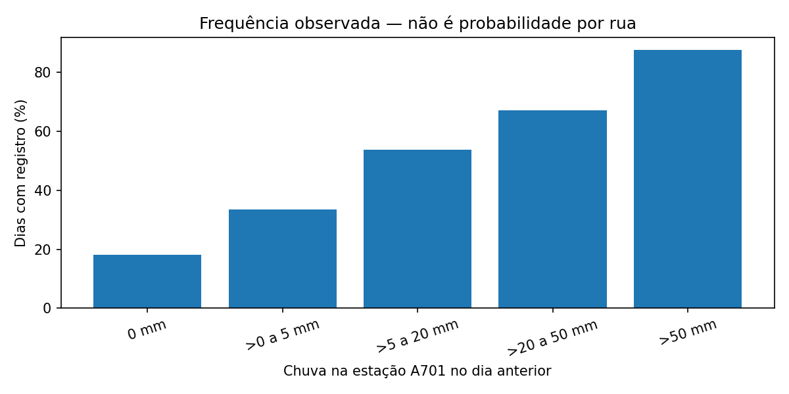

# ALERTASP

**Dados e tecnologia para compreender alagamentos e inundações na cidade de São Paulo.**

O ALERTASP é uma proposta CitizenTech desenvolvida por estudantes de Engenharia de Software da FIAP. O projeto busca tornar informações sobre ocorrências de alagamento mais acessíveis e compreensíveis para quem vive ou se desloca pela capital paulista.

Nesta implementação, o foco é o estudo de **Inteligência Artificial & Machine Learning**: investigamos se a chuva observada anteriormente na estação São Paulo–Mirante (INMET A701) ajuda a estimar a possibilidade de **haver ao menos um registro de alagamento ou inundação no município no dia seguinte**.

## Ficha CitizenTech

| Elemento | Descrição |
|---|---|
| **Território** | Município de São Paulo (SP) |
| **Cidadãos beneficiados** | Moradores, pedestres e motoristas que precisam compreender as condições de chuva e os registros de alagamentos |
| **Problema** | Durante chuvas intensas, nem sempre é fácil consultar e interpretar informações localizadas e atualizadas sobre ocorrências de alagamento |
| **Proposta** | Combinar informações públicas sobre chuva e ocorrências históricas para apoiar análise territorial e comunicação mais clara ao cidadão |
| **Tecnologias** | Python, Pandas, scikit-learn, Google Colab, GeoSampa e dados históricos do INMET |
| **Ecossistema de dados** | Prefeitura de São Paulo/Defesa Civil (SIGRC e GeoSampa), INMET; CGE como referência de comunicação oficial |
| **Como avaliar a contribuição** | Qualidade, cobertura e clareza das informações; no experimento de ML, métricas de classificação, ordenação e calibração. Impacto real sobre cidadãos ainda não foi medido |
| **ODS relacionados** | 11 — Cidades e Comunidades Sustentáveis; 13 — Ação Climática; 3 — Saúde e Bem-Estar (complementar) |

## O estudo de Machine Learning

A análise utiliza dados públicos reais de **2013 a 2026**: registros administrativos de alagamento e inundação do GeoSampa e medições horárias de precipitação do INMET A701. A unidade de análise é **a cidade inteira em um dia**, não uma rua ou bairro.

O modelo desenvolvido é um **Random Forest**, comparado a referências simples de frequência histórica e sazonalidade. As variáveis incluem chuva dos dias anteriores e época do ano; o modelo não utiliza chuva do dia que pretende estimar.

Em 2025, o modelo calibrado obteve **Average Precision de 0,6233**, acima do baseline mensal (0,5682), mas apresentou **Brier Score de 0,1395**, ligeiramente pior que o baseline (0,1387). Assim, os resultados indicam capacidade de identificar padrões, **não confiabilidade suficiente para divulgar porcentagens como alertas operacionais**.

*Frequências observadas em dados históricos, não limites oficiais de chuva nem probabilidades por via.*

## Explore o repositório

- [Notebook executado — análise, treinamento e avaliação](ml/01_ALERTASP_PREVISAO_CHUVA_A701.ipynb)
- [Metodologia, resultados e execução no Colab](ml/README.md)
- [Relatório de IA & Machine Learning](ml/RELATORIO_ML.md)
- [Fontes e dicionário dos dados](ml/dados/README.md)
- [Gráficos](ml/figuras/chuva_a701/) e [evidências](ml/evidencias/chuva_a701/)

**Limite de uso:** uma estação meteorológica não representa a chuva de cada bairro. A ausência de registro não comprova ausência de alagamento. O estudo **não oferece previsão por rua, rotas seguras ou monitoramento em tempo real** e não substitui os comunicados do CGE e da Defesa Civil.

## Equipe

- Enzo Almeida — RM556900
- Guilherme Moreira — RM557290
- Gabriel De Mello — RM554421

*FIAP · Global Solution 2026.2 · CitizenTech*
